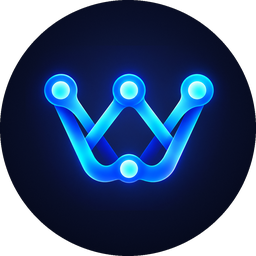

  

<h1 align="center">Waymark ($WYMK)</h1>

  The community token of Waymark, an independent map of crypto wallets.

---

## About

Waymark compares 22 self-custody crypto wallets across 21 chains: which networks each wallet supports, which cross-chain swaps it can do in the app, what it charges, and its security history.

$WYMK rewards people who keep that data accurate. Users who report outdated wallet information, and whose report is confirmed, earn points that convert to WYMK. Holders vote on which wallets and chains are added next. Wallet rankings on Waymark can never be bought with the token.

## Token details

| Field | Value |
|---|---|
| Name | Waymark |
| Symbol | WYMK |
| Network | BNB Smart Chain (BEP-20) |
| Contract | `0xdA8eac0F4104051a0865899918B266D879a37347` |
| Max supply | 10,000,000,000 WYMK |
| Locks and vesting | None |
| Main pool | WYMK/USDT on PancakeSwap V3 |
| Pool address | `0x5c14c118f488092ea575ec0cb5faa70a16dcd71f` |

Only trust this contract address. Anyone can create a token with the same name.

## Links

| | |
|---|---|
| Website | WEBSITE_URL |
| Telegram channel | https://t.me/waymarkhelp |
| Telegram chat | https://t.me/waymarkchat |
| X (Twitter) | https://x.com/Waymarkhelp |
| BscScan | https://bscscan.com/token/0xdA8eac0F4104051a0865899918B266D879a37347 |
| GeckoTerminal | https://www.geckoterminal.com/bsc/pools/0x5c14c118f488092ea575ec0cb5faa70a16dcd71f |
| DexScreener | https://dexscreener.com/bsc/0x5c14c118f488092ea575ec0cb5faa70a16dcd71f |
| Buy on PancakeSwap | https://pancakeswap.finance/swap?chain=bsc&outputCurrency=0xdA8eac0F4104051a0865899918B266D879a37347&inputCurrency=0x55d398326f99059fF775485246999027B3197955 |

## Tokenomics

Total supply: 10,000,000,000 WYMK. All allocations are held in public wallets that anyone can check on BscScan.

| Allocation | Share | WYMK | Wallet |
|---|---|---|---|
| Community rewards | 30% | 3,000,000,000 | [`0xde6939E4DAD453828964e4CE409533E69D793C1e`](https://bscscan.com/token/0xdA8eac0F4104051a0865899918B266D879a37347?a=0xde6939E4DAD453828964e4CE409533E69D793C1e) |
| Points airdrop | 15% | 1,500,000,000 | [`0x1c5C98089e5c3eb2488C47D9c72452937fFE7336`](https://bscscan.com/token/0xdA8eac0F4104051a0865899918B266D879a37347?a=0x1c5C98089e5c3eb2488C47D9c72452937fFE7336) |
| Treasury and ecosystem | 15% | 1,500,000,000 | [`0x62619E42D7baEde7B4bB3eF4501aF3E202f208bB`](https://bscscan.com/token/0xdA8eac0F4104051a0865899918B266D879a37347?a=0x62619E42D7baEde7B4bB3eF4501aF3E202f208bB) |
| Starting liquidity | 10% | 1,000,000,000 | [`0xe3947791d92F2ab8F3a9Cb7D9C158C201c7519dA`](https://bscscan.com/token/0xdA8eac0F4104051a0865899918B266D879a37347?a=0xe3947791d92F2ab8F3a9Cb7D9C158C201c7519dA) |
| Market maker | 10% | 1,000,000,000 | same wallet as starting liquidity |
| Marketing and listings | 10% | 1,000,000,000 | [`0xf85E86C968877CCc7A81793279E00584831c4db9`](https://bscscan.com/token/0xdA8eac0F4104051a0865899918B266D879a37347?a=0xf85E86C968877CCc7A81793279E00584831c4db9) |
| Team | 10% | 1,000,000,000 | [`0xa4229cB4f0e424bf3973dE6b5fD3f1d3cB25F397`](https://bscscan.com/token/0xdA8eac0F4104051a0865899918B266D879a37347?a=0xa4229cB4f0e424bf3973dE6b5fD3f1d3cB25F397) |

## Utility

- **Earn by contributing:** confirmed corrections, new wallet data and incident reports are rewarded in WYMK.
- **Stake to review:** a small stake is needed to post a wallet review. Spam or fake reviews lose the stake.
- **Vote on coverage:** holders choose which wallets and chains are added next. Never scores or rankings.
- **Premium features:** alerts when a wallet has an incident or drops a chain, and an API for builders.
- **Tips:** send WYMK tips to contributors through TipDrop.

## Roadmap

- [x] Points for confirmed reports
- [x] Tokenomics published
- [x] Liquidity pool live on PancakeSwap
- [ ] Points airdrop
- [ ] Monthly contributor rewards, review staking and voting

## Brand assets

All logo files are in the root of this repository.

| File | Use |
|---|---|
| `wymk-32.png` | BscScan token icon (32×32) |
| `wymk-200.png` | GeckoTerminal / CoinGecko icon (200×200) |
| `wymk-256.png`, `wymk-512.png`, `wymk-1024.png` | Round token icon, larger sizes |
| `wymk-square-*.png` | Square icon versions |
| `waymark-mark-transparent.png` | Logo mark on a transparent background |
| `waymark-banner-1500x500.png` | Header banner (3:1) |

## Disclaimer

$WYMK is a community token. Nothing in this repository is financial advice or a promise of value. Crypto prices can fall to zero. Always check the contract address before trading.
